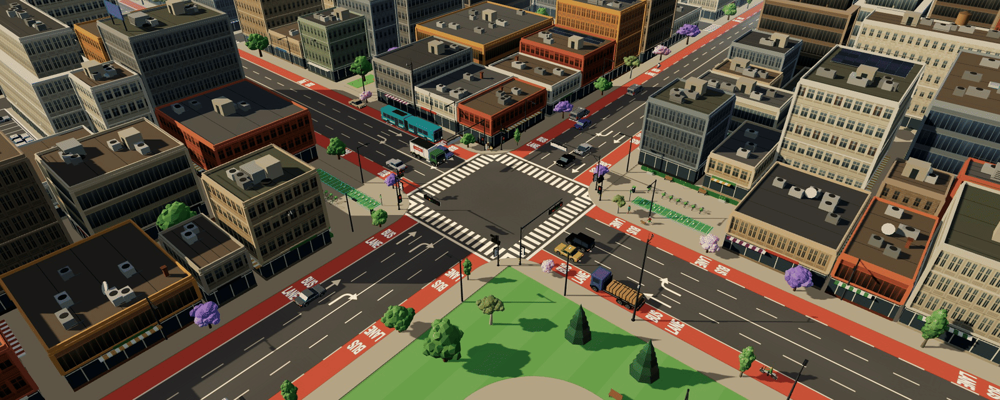
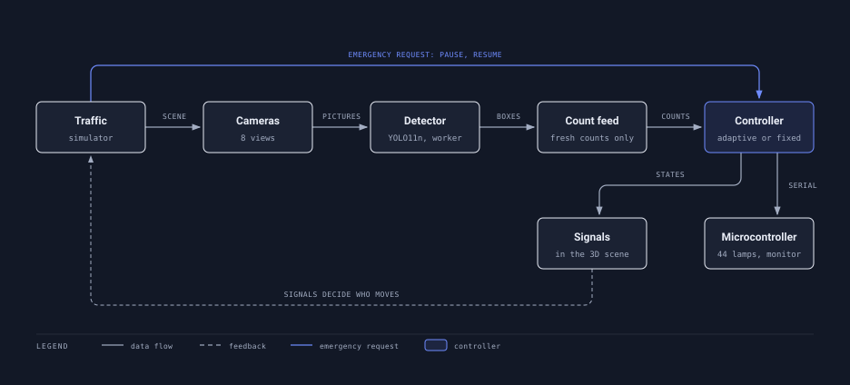
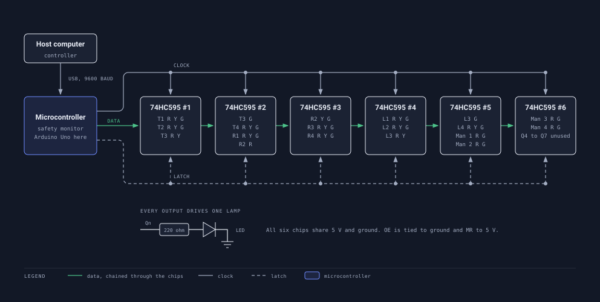
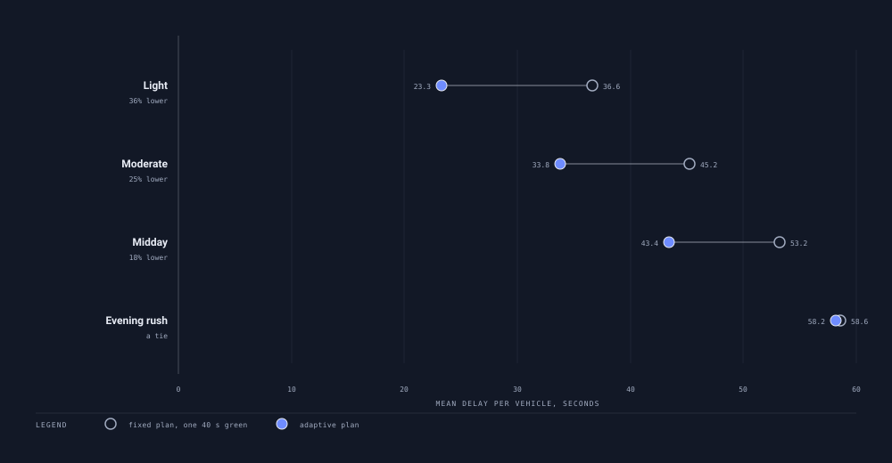

# 🚦 Adaptive Traffic Signal



## Overview

A four-way junction that sets its own green times from the traffic it sees. It runs in your browser as a 3D scene with vehicles, people, a park and a bus lane. You can send an ambulance down any road, press a crossing button, and compare the adaptive plan with a fixed one on the same traffic. A camera detector can take over the counting. It lives at <https://adaptive-traffic-signal.ariadaikalam.com>.

## Take a look

| Part | What it shows |
|---|---|
| Scene | The junction in 3D. Drag to move, pinch or scroll to zoom, right drag to turn |
| Comparison | Fixed and adaptive plans on the same traffic, and the results tables |
| Cameras | The view from each of the eight detection cameras, with a box round every vehicle it counts |
| Controls | Fixed or adaptive timing, simulator or detector counts, an emergency vehicle, a crossing button, the time of day and the weather |

Add `?flat` to the address for the 2D view.

## Why we built it

It began as hardware: a microcontroller (we used an Arduino), twelve LEDs and a YOLO detector watching a webcam. A model on a desk is hard to show, so we built a simulator that runs in a browser. The simulator let us explore much more. We could try timing rules, compare them on the same traffic and see how far adaptive timing helps and where it does not. The algorithm came out of that work. Then we wrote the hardware side again to match it: the firmware and the serial protocol.

## How it works

<picture>
  <source media="(prefers-color-scheme: dark)" srcset="docs/diagrams/architecture-light.svg">
  
</picture>

The controller picks the next phase and its green time from the vehicles waiting on each road. It is pure logic, so the same rules exist in Python, in JavaScript and as a C++ safety monitor for the microcontroller. All three pass the same test vectors.

With the detector on, the page photographs each camera in turn, cuts the picture to the road that camera owns, and runs a small model in a web worker. The boxes become counts for the controller.

- Opposing roads run together. Every green ends in a 4 s yellow and a 2 s all-red.
- Green time is the clearance time of the waiting vehicles divided by the lanes, kept between 5 and 60 s.
- A count that is missing or old never shortens a green or skips a phase.
- A crossing button starts a walk of at least 6 s beside a compatible green.
- An emergency vehicle sends a request when it enters a road's geofence, a polygon around the road's approach lanes, and a running green is held for it.

The reasons are in [decisions](docs/decisions.md).

## The hardware side

The firmware drives 44 lamps through six 74HC595 shift registers on three pins. The host sends one line of signal states at 9600 baud, and a safety monitor on the microcontroller checks every line before the lamps change. It trips to flashing red on a damaged line, an unsafe state or 3 s of silence. The monitor is plain C++ with no Arduino dependency. It runs on a computer too and passes the same test vectors as the controller, so any board that can read a serial line and drive three pins can run it. The sketch in `firmware/` is written for an Arduino Uno. The line format is in [controller](docs/controller.md).

<picture>
  <source media="(prefers-color-scheme: dark)" srcset="docs/diagrams/circuit-light.svg">
  
</picture>

## Results

Mean delay per vehicle in seconds. Both plans meet the same simulated traffic, 10 runs of one hour each. The fixed plan is one 40 s green for the whole day.

| Traffic | Fixed | Adaptive |
|---|---|---|
| Light | 36.6 | 23.3 |
| Moderate | 45.2 | 33.8 |
| Midday | 53.2 | 43.4 |
| Evening rush | 58.6 | 58.2 |

<picture>
  <source media="(prefers-color-scheme: dark)" srcset="docs/diagrams/results-light.svg">
  
</picture>

Adaptive ties at the rush, where a fixed 40 to 50 s green is about the best any single plan can do. Emergency vehicles wait about a quarter as long: 7.9 s against 31.4 s in moderate traffic.

The detector finds 99.6% of the vehicles a camera can see, and its count is within one vehicle of the truth in 99.1% of pictures. Driving the controller at midday it gives 21% less delay than the fixed plan. At the rush it is within the spread of both plans. The model is 11 MB and takes 36 ms a picture in the browser. See [results](docs/results.md).

## Care taken

- **Never two conflicting greens.** A whitelist of movements that may run together, checked in the engine, the fuzz test, the serial parser and the firmware monitor.
- **Fails safe.** A late, missing or impossible camera result gives that road its default green. Emergency priority does not use pictures.
- **The same traffic in every comparison.** Arrivals come from a seeded stream that does not depend on the signals.
- **Pictures stay in the browser.** The detector loads only if you switch it on, and nothing is sent anywhere.
- **Pinned and restricted.** Three.js is pinned by version and hash, and the page has a strict content security policy.

## Documentation

- [Decisions](docs/decisions.md): each main choice, its reason and what was rejected.
- [Results](docs/results.md): every measured result, with its method.
- [Controller](docs/controller.md): the rules, the serial protocol and the safety monitor.
- [Simulator](docs/simulation.md): what is modelled and how it is checked.
- [Detector](docs/detector.md): the cameras, the training data and the targets.
- [The scene](docs/scene.md): the models, the sun and light, and the view controls.
- [Security](docs/security.md) and [timing sources](docs/timing-sources.md).

## Data and credits

- **Weather**: [Open-Meteo](https://open-meteo.com/), under [CC BY 4.0](https://creativecommons.org/licenses/by/4.0/).
- **Timing values**: road authority standards, with the source for each in [timing sources](docs/timing-sources.md).
- **The detector** is trained on pictures from this project's own scene. No outside dataset is used.

## Built with

| Part | Used for |
|---|---|
| JavaScript, Three.js | The controller port, the simulator and the 3D scene, with no build step |
| Python | The controller specification and the tests |
| C++ | The safety monitor, and an Arduino sketch for 44 lamps |
| YOLO11n, ONNX Runtime Web | The vehicle detector, in the browser |
| Ultralytics, PyTorch | Training and export |
| Vercel | Hosting |

## How it was built

- **Claude (Sonnet 5.5)**: wrote the implementation. All of us made the decisions.
- **VibeSec Pro**: the security checks, from [vibesec.sh](https://vibesec.sh).

## Run it yourself

```
git clone https://github.com/ari-adaikalam/Adaptive-Traffic-Signal
cd Adaptive-Traffic-Signal
python3 web/tools/serve.py
```

Open <http://127.0.0.1:8765/> in a browser with WebGL. To run the tests:

```
cd web && npm test
python -m pytest
```

The firmware tests need `g++` or `clang++`, and are skipped without one.

## License

The code is under the MIT License, see [LICENSE](LICENSE). The detector model and the two scripts that train and export it use Ultralytics YOLO and are under the AGPL-3.0, see [NOTICE](NOTICE).

## Contact

Built by Ari Adaikalam, Asvikaa K M R and Jeyakkavi M, and maintained by Ari Adaikalam. [Portfolio](https://ariadaikalam.com) | [Email](mailto:ariadaikalam1234@gmail.com)

Bug reports and suggestions are welcome. For a security problem, read [SECURITY.md](SECURITY.md) first.
