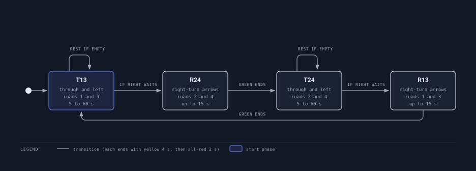
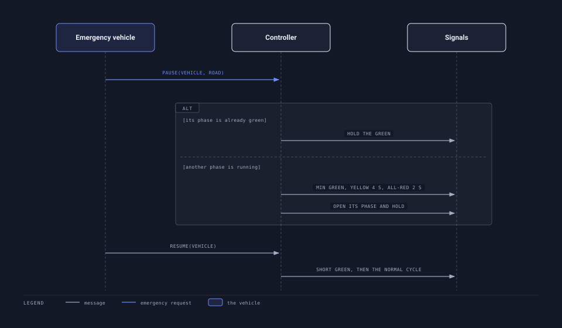
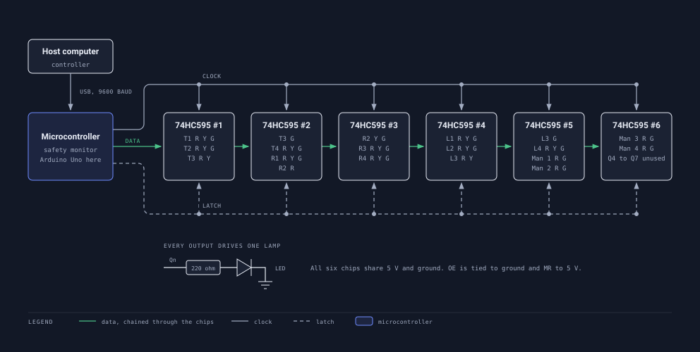

# Controller

The rules of the signal controller for one four-way junction with left-hand traffic. The tests are the exact specification. The reasons are in [decisions](decisions.md).

The controller exists three times: a Python specification (`traffic_controller/`), a JavaScript port that the page runs (`web/src/signals.js`), and the microcontroller firmware (`firmware/`, an Arduino sketch around a plain C++ monitor that any board can run), whose safety monitor sits between the serial line and the lamps. All three pass the same JSON vectors in `tests/vectors/`. The firmware was written to match the rules the simulator settled on.

## Movements and conflicts

Roads 1 to 4 run clockwise from above, and road i faces road i+2. A left turn travels with the through movement. A right turn has its own arrow.

| Movement | Meaning |
|---|---|
| T1 to T4 | through and left turn from road i |
| R1 to R4 | right-turn arrow from road i |
| L1 to L4 | left-turn arrow, lit only in an arrow phase |
| C1 to C4 | pedestrian crossing over leg j |

Two movements run together only if the whitelist allows it, and there are 44 allowed pairs. The main ones:

- T_i with T_(i+2), and R_i with R_(i+2).
- Any crossing with any other crossing, and with the through movements of the two roads beside it.
- L_i with the through movements of its own road and the road opposite, with any other L, and with R_j unless j is opposite i. L_i never runs with a crossing.

## Phases

<picture>
  <source media="(prefers-color-scheme: dark)" srcset="diagrams/cycle-light.svg">
  
</picture>

Four phases in a fixed cycle, so no road can starve: R13, T13, R24, T24, starting at T13. A crossing is served with the through phase of the road beside it.

An arrow phase runs only when its right-turn lane is known to hold a vehicle, and it never rests. Every phase ends in a yellow, then an all-red. The next phase is chosen when a green ends:

- A phase known to be empty is skipped, at most `max_skips` times in a row.
- If every other phase is empty, the current one rests in green.
- A phase with unknown demand is never skipped.
- A waiting pedestrian counts as demand.

The left arrow L_i lights with the arrow phase of the other pair, where every crossing is red.

## Timing

- **Through green** is `ceil(clearance time / lanes)` for the busier of its two roads, kept between `min_green` (5 s) and `max_green` (60 s).
- **Arrow green** is the whole clearance time of the right-turn lane, kept between 5 s and `max_arrow_green` (15 s).
- **Yellow** is 4 s and **all-red** 2 s, for a 60 km/h road. Sources are in [timing sources](timing-sources.md).
- **Counts** arrive per road. One older than `count_ttl` is ignored, and a road with no fresh count takes `default_green`. The green is planned from the median of the last 3 reports.
- Each road reports the through and left lanes, and the right-turn lane. While the bus lane is active it reports a third count.

## Pedestrians

- A button press is latched. A walk starts only when a compatible green opens.
- The walk lasts at least 6 s. The flashing red man then runs for `ceil(width / 1.2 m/s)` s in total, through the yellow, and a solid red man shows in the all-red. The flashing is never cut short.
- A phase that served pedestrians always hands over to the next, so the flashing can run through the yellow.

## Emergency priority

<picture>
  <source media="(prefers-color-scheme: dark)" srcset="diagrams/emergency-light.svg">
  
</picture>

A vehicle sends `pause(vehicle, road, movement)` when it enters a road's zone, and `resume(vehicle)` when it leaves. The movement is `through`, `left` or `right`, and a right turn is served in the arrow phase.

- Requests are served oldest first. At most 16 are held. One that gets no `resume` expires after 60 s.
- **Phase already green:** it is held.
- **Another phase running:** it keeps its green to the minimum, then ends through a full yellow and all-red with every flashing clearance whole. The emergency phase opens and is held.
- After a `resume` or a timeout, the held green gets a short fixed green. No walk starts while an emergency is active.

## Geofence

A vehicle's position decides which road it is on, and so which green to hold. Each road has a zone, a polygon of [longitude, latitude] points around its approach lanes. The position is tested with the even-odd point-in-polygon rule.

- A point strictly inside a polygon is in the zone. A point on an edge is outside.
- If two zones overlap, the lower road number wins.
- A zone needs at least 3 distinct points. A position that is not a finite number, or is out of range, is refused.
- The Python specification (`traffic_controller/geofence.py`) and the JavaScript port (`web/src/geofence.js`) share the vectors in `tests/vectors/geofence.json`.

The simulator has no map coordinates, so the page's emergency vehicles send their request when they are within 120 m of the stop line.

## Bus lane

The lane is always painted, and a schedule makes it active (default windows Monday to Friday 07:00 to 09:00 and 16:00 to 18:00). While it is active:

- General traffic has one lane fewer, and the bus lane is counted on its own. The green is the larger of the two.
- A waiting bus counts as demand.
- **Early green.** The running green ends early when the phase that opens next has a bus waiting and the running one has none. It keeps the minimum green, the walk minimum and every flashing clearance, and never hits the same phase twice running.
- **Extension.** A green with a bus still waiting runs up to 5 s longer, once per period, never while a crossing is served.

Emergency priority comes before both.

## Modes and faults

- **Adaptive** uses every count. **Fixed** ignores them and runs default timing, which is also what happens when detection fails.
- **Startup.** Every vehicle signal flashes red for 5 s, then stays all red for the all-red time.
- **Fault** (`manual`, `link` or `conflict`). All vehicle signals flash red and every crossing is solid red. Clearing it goes back through startup.

## The monitor on the microcontroller

<picture>
  <source media="(prefers-color-scheme: dark)" srcset="diagrams/circuit-light.svg">
  
</picture>

The monitor sits between the serial line and the lamps and does not trust the host.

- A damaged line is ignored and counts as silence.
- An intact line with unsafe signals trips a fault at once.
- Silence for 3 s trips a fault.
- A fault ends after 3 consecutive seconds of good lines with no conflict. The lamps then stay all red for 3 s before they follow the host.
- At power up the monitor is in a fault.

## Serial protocol, version 3

One line at 9600 baud: `V3 <16 characters> <2 hex digits>`, for example `V3 GRGRRRRRRRRRSWSW D2`. The characters are T1 to T4, R1 to R4, L1 to L4 and C1 to C4. Vehicle and arrow signals use `R Y G F` (F is flashing red). Crossings use `S W C` (solid red man, walk, flashing red man). The checksum is CRC-8 with polynomial 0x07. Either all twelve vehicle and arrow signals flash, or none do. The line is parsed strictly, and the same conflict whitelist applies on both sides.

## Settings the page turns on

These settings are off in the controller by default. The page turns them on. All three implementations have them, and 30 random runs with them on are replayed from the Python engine into the JavaScript port.

- `left_window`: the 6 s arrow window after a through phase that served pedestrians. No left count is needed.
- `left_follow`: pedestrian time ends with the crossing time, and the left arrow then lights with the through green. It applies only inside `left_follow_windows`, the weekday peaks.
- `fault_signal: red`: a fault is a yellow, then all-red, with every crossing solid red after the people already on it finish.
- `hold_walk_timed`: a green held for an emergency does not keep the man on walk.
- The movement of an emergency request (`through`, `left` or `right`).

One more setting, `left_clear_arrow`, is in the JavaScript port only. It is display only. In a through phase that served pedestrians, the left arrow the page shows turns green when the flashing red man starts and stays green through the yellow and the all-red into the arrow phase, where the left arrow already lights. A left turner who clears the junction then always has an arrow. Vehicles, pedestrians and timings never read it, so they are exactly what they are without it. If no arrow phase follows, or an emergency cuts the phase, the shown arrow ends with the through yellow.
