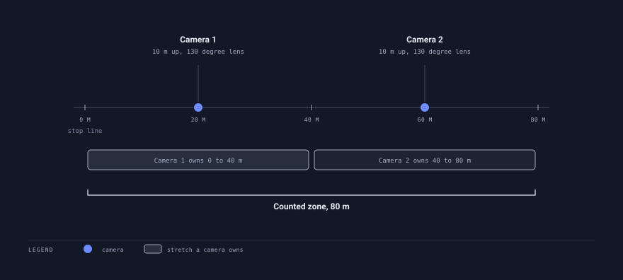

# Detector

The controller can take its vehicle counts from a detector that looks at pictures from the scene's cameras. It is switched on in Controls (Counts: Detector) and runs in the visitor's browser. The scores are in [results](results.md).

## The cameras

<picture>
  <source media="(prefers-color-scheme: dark)" srcset="diagrams/cameras-light.svg">
  
</picture>

Each road has two cameras on low buildings (or poles), about 10 m up, at roughly 20 m and 60 m from the stop line. They look across the road with a 130 degree lens. The counted zone is the first 80 m. The reasons are in [decisions](decisions.md#the-cameras).

## From picture to count

1. **A camera owns a stretch.** The zone is split halfway between cameras: the near one owns 0 to 40 m, the far one 40 to 80 m. A vehicle is counted by the camera that owns the place where it meets the road.
2. **Crop.** The picture is cut to the owned stretch plus 8 m each side, the width of the three lanes, and 3.8 m high.
3. **Mask.** Everything outside this road's lanes is painted flat grey, so the model never sees a parallel lane.
4. **Model.** The crop is scaled to 640 pixels wide and run through YOLO11n in a web worker, with ONNX Runtime Web on one thread. One camera is taken every 125 ms.
5. **Put on the road.** The middle of each box's bottom edge is projected onto the road and corrected for the near side of the body.
6. **Count.** A detection counts only if it stands in the lanes and in the stretch this camera owns. Two cameras' detections that are within 3 m of the line between them, of one class and within 1.5 m along and 1.2 m across of each other, are one vehicle.
7. **Feed.** The feed gives the controller one count for a road, or nothing.

The classes are the controller's four: cars (car, van, police car, ambulance), trucks (truck, semi, fire engine), buses (bus, articulated bus) and bikes (bicycle, scooter).

## When detection fails

The controller treats a missing or old count as unknown, so that road takes the default green and never skips a phase. The feed turns every failure into that case.

| Situation | What happens |
|---|---|
| A result older than 3 s | That camera has no result |
| The worker stopped or the model failed to load | Every road is unknown, and the page says detection is off |
| One camera of a road returns nothing | The road is unknown, because a count with a stretch missing is too small |
| A result is impossible (negative, fractional, over 30 vehicles, a jump of over 14, a clock that goes back) | It is thrown away, and the last trusted result carries on for 3 s |
| An emergency vehicle is on the road | Nothing changes, because its priority does not use pictures |
| Detection comes back | The first new result is trusted, and old reports have already aged out |

With detection on, the page holds normal speed, because counts would be stale at 4 or 12 times speed.

## Training data

All pictures come from the scene, so the labels are exact.

- **Labels.** Eight corners of each vehicle's box are projected through the lens. A vehicle is left out if it is behind the lens, under half in the frame, or under 8 pixels across. Nine points on it are tested against buildings and other vehicles, and it is labelled if at least 40% are seen.
- **A run** is one page load with a fixed seed. The simulation runs 90 s to fill the road. Then 60 times it advances 8 to 20 s and all eight cameras are captured.
- **The plan is 52 runs.** 28 train, 6 validate and 6 test, split by run and never by picture. 12 more are held out: night with rain, which no other run has. Training covers four weathers and twelve hours.
- Each picture is saved with its labels and the true count of vehicles in the stretch, hidden ones included.

The pictures and weights (about 500 MB) are not in the repository. The tools are.

## The model

YOLO11n has about 2.6 million parameters. It starts from Ultralytics' published weights, trained on everyday photographs. It trains for 30 epochs at size 640, batch 16, seed 0, with no flipping. The export is 11.1 MB. The longer 50 epoch run was only kept if it beat the first by 0.5 point, set in advance. It did not.

## Targets, set before any model was tested

"95% of pictures with the exact count" was rejected. With eight vehicles in view it needs 99.4% per vehicle, and a vehicle more or less changes a green by about two seconds. The targets come from what the controller can stand: it keeps most of its advantage up to about 10% of vehicles missed.

1. Precision and recall at least 0.95, and at least 0.90 for each class.
2. Mean count error at most 0.5, bias within plus or minus 0.25, and at least 95% of pictures within one vehicle.
3. No group of hour, weather, vehicles in view or camera below 90% within one.
4. With the detector driving the controller, delay within 5% of the simulator's counts, ahead of fixed at midday, no worse at the rush, no phase starved.
5. Training F1 within 3 points of test.
6. Night with rain, held out of training, at least 0.90.
7. At most 15 MB, and about a third of one core for eight cameras at one picture a second each.

## Reproduce it

```
python3 web/tools/serve.py --collect datasets/detection
node web/tools/collect-run.mjs 0 51
python tools/train_detector.py --epochs 30 --patience 6 --name run1
python tools/export_detector.py runs/detect/run1/weights/best.pt datasets/models/run1.onnx
node web/tools/detect-eval.mjs datasets/models/run1.onnx test 0.25
```

`collect-run.mjs` needs puppeteer-core, and the evaluation needs `onnxruntime-node` and `jpeg-js`. The site serves `web/models/detector.onnx`. The code is in `web/src/detection/`, with tests in `web/test/`. Ultralytics is AGPL-3.0, so the model and the two scripts that use it are under that licence, see [NOTICE](../NOTICE).
