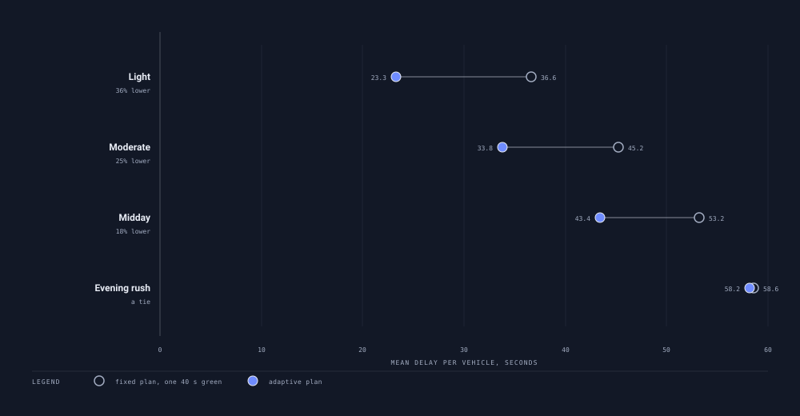

# Results

Every measured result, with how it was measured. The reasons for the choices are in [decisions](decisions.md).

## Fixed against adaptive

The simulator runs the same seeded traffic through both plans, 10 runs of one hour each. Adaptive counts vehicles through the simulated cameras, with a 40 s cap on a green. The baseline is one 40 s green for the whole day. A plan tuned to each demand is the hardest case. See [simulation](simulation.md).

<picture>
  <source media="(prefers-color-scheme: dark)" srcset="diagrams/results-light.svg">
  
</picture>

Mean delay per vehicle in seconds:

| Traffic | Day plan | Tuned plan | Adaptive | Runs adaptive won |
|---|---|---|---|---|
| Light | 36.6 | 24.5 | 23.3 | 10 of 10 |
| Moderate | 45.2 | 34.9 | 33.8 | 10 of 10 |
| Uneven | 55.4 | 55.4 | 38.8 | 10 of 10 |
| Changing day | 49.6 | 46.3 | 35.7 | 10 of 10 |
| Bus hours | 42.5 | 36.5 | 34.1 | 10 of 10 |
| Constant peak | 98.6 | 117.7 | 98.8 | 4 of 10 |
| Morning rush | 61.0 | | 58.9 | 6 of 10 |
| Midday | 53.2 | | 43.4 | 10 of 10 |
| Evening rush | 58.6 | | 58.2 | 5 of 10 |

Adaptive wins clearly except at the rushes and the constant peak. There a fixed 40 to 50 s green is about the best any single plan can do, and adaptive matches it. At moderate traffic adaptive also cuts queues from 17.4 to 12.2 vehicles and pedestrian wait from 43.2 to 33.6 s.

## Emergency vehicles

About 150 vehicles per plan, one every 4 minutes for an hour, 10 runs. The wait runs from the moment the vehicle is on the road to the stop line, less the time to drive in. The fixed plan has no priority, and the vehicle crosses a red only when the way is clear.

| Traffic | Plan | Mean (s) | Worst (s) |
|---|---|---|---|
| Light | Fixed | 19.6 | 90.6 |
| Light | Adaptive | 5.5 | 22.1 |
| Moderate | Fixed | 31.4 | 141.3 |
| Moderate | Adaptive | 7.9 | 26.8 |
| Heavy | Fixed | 56.4 | 382.0 |
| Heavy | Adaptive | 16.4 | 111.3 |

No run had a conflict in the junction. Up to 40 vehicles sent at once never caused a conflicting signal or a crash.

## How many missed vehicles the controller can stand

The cameras were made to miss more vehicles, 6 runs of 30 minutes. Mean delay in seconds:

| | Fixed | 0% missed | 10% | 20% | 30% |
|---|---|---|---|---|---|
| Midday | 52.3 | 44.6 | 43.0 | 42.7 | 42.8 |
| Evening rush | 53.8 | 49.5 | 50.9 | 50.0 | 53.9 |

At the rush adaptive stays about 5% better up to 10% missed, and loses its advantage at 30%.

## The detector

Scored on pictures from simulation runs it never saw. The count is a camera's stretch against the true number there, hidden vehicles included.

| Runs | Pictures | Precision | Recall | Count error | Within one |
|---|---|---|---|---|---|
| Training sample | 572 | 0.986 | 0.996 | 0.066 | 99.5% |
| Validation | 2,185 | 0.979 | 0.995 | 0.121 | 98.7% |
| **Test** | 2,034 | 0.984 | 0.996 | 0.104 | 99.1% |
| Night with rain, held out | 2,238 | 0.988 | 0.995 | 0.014 | 100% |

Every circumstance on the test runs is at least 97.7% within one vehicle. The weakest is six or more vehicles in view, because some are hidden in a queue. By class, precision is 0.966 to 0.990 and recall 0.992 to 0.996. All seven targets in [detector](detector.md#targets-set-before-any-model-was-tested) are met.

The night-rain test turned out easy. A road at night is nearly empty, and the grey mask removes the wet surroundings.

A 50 epoch run beat the 30 epoch one by 0.10 point of F1, under the 0.5 point set in advance, so the 30 epoch model stays.

## Delay with the detector driving the controller

The page's detector works in real time, so the run is stepped by hand. After each 0.1 s step the page draws a frame and takes a camera picture, four steps in five. Each case is a clear Monday, with 7 minutes of warm-up on the simulator's counts, then 30 minutes measured. The page's clock is frozen, so a seed gives the same traffic each time.

| | Fixed | Simulator's counts | Detector |
|---|---|---|---|
| Midday, 3 runs | 57.0 | 47.3 | 44.8 |
| Evening rush, 12 runs | 57.7 | 54.3 | 56.0 |

At midday the detector is 21% below the fixed plan. At the rush it is within the spread of both: 1.7 s above the simulator's counts (plus or minus 2.2) and 1.7 s below the fixed plan (plus or minus 3.6). The controller had a count for every road on every tick. The average error of a road's count was 0.58 vehicle.

## Cost in the browser

- **Download.** The model is 11.1 MB and the runtime about 11 MB, loaded only when the switch is on.
- **Time.** 36 ms a picture in a worker, so eight cameras at one picture a second use about 29% of one core. The frame time stays 16.6 ms with the detector on or off.
- **Live counts.** At the rush, a road's count was within one vehicle 99.6% and 97.8% of the time in two runs. It fell to 93.3% when the machine was busy, because the detector was late.
- **The scene.** About 1.4 s to the first frame, 4.8 ms average frame cost, and 350 to 480 MB of heap. Measured in Chrome on a Mac.
